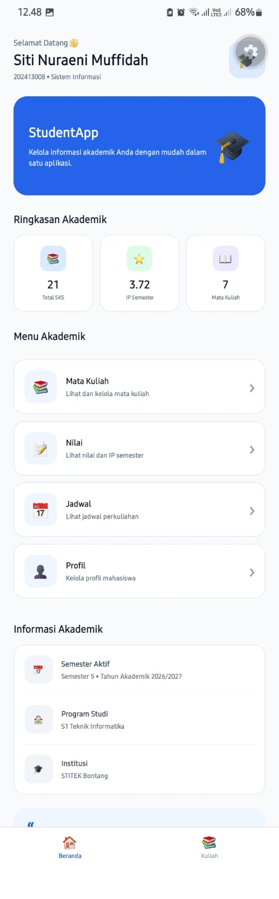
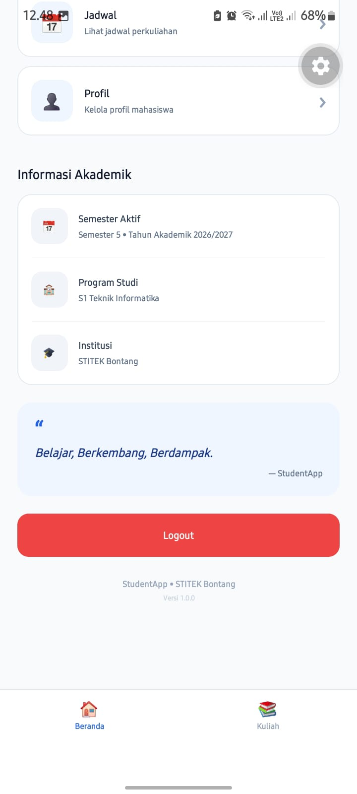

# StudentApp2

Kelompok 3 - Pemrograman Aplikasi Bergerak

Aplikasi StudentApp2 merupakan aplikasi mobile untuk mengelola informasi mahasiswa dan mata kuliah.

## Tampilan Aplikasi

### 1. Halaman Login

### 2. Halaman Beranda

### 3. Halaman Mata Kuliah

### 4. Halaman Logout

## Teknologi

- React Native
- JavaScript
- AsyncStorage
